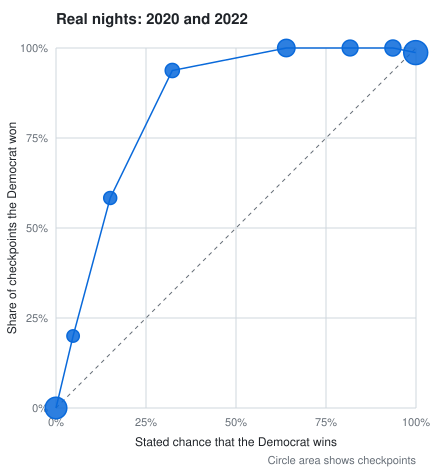
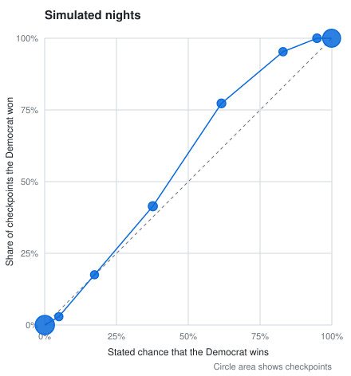
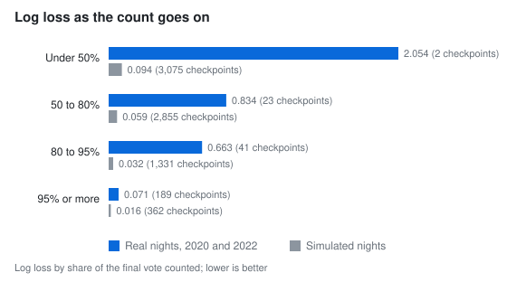

# Estimating final results from partial county counts on election night

electionsarchive.com, November 3, 2026

## Summary

On election night, electionsarchive.com estimates each race's final margin, its final turnout, and each candidate's chance of winning from county counts as they come in. This paper describes the model, the backtest we ran on it, and its scores.

The model projects each county's final turnout and margin from an earlier election, the counties that have already reported, and county demographics, and it simulates the uncounted vote 500 times. Two of its parts get most of the attention here:

1. **Vote-mode swings measured within the count.** Mail, early in-person, and Election Day votes often lean different ways, and counties count them in different orders. The model compares, county by county, the margin among the votes counted later with the margin among the votes counted earlier. When those swings are larger than ordinary differences between batches, it adds a shared shock to the votes still out, in proportion to how many remain.
2. **Averaged win chances.** Instead of reporting the share of simulations each candidate wins, the model computes each candidate's chance within every simulation, by integrating out the shared Gaussian shocks in closed form, and averages those chances. This is a Rao-Blackwellized estimate: it has the same expectation as the share of simulations won, with less simulation noise.

We replayed 477 simulated nights and 12 real ones, county by county, and scored the model at every checkpoint. On the simulated nights (7,623 checkpoints), the Brier score is 0.021 (90% interval 0.016 to 0.026), the log loss is 0.067 (0.052 to 0.081), and the 80% range held the final margin 87% of the time. Under the site's call rule, the model called 436 of the 477 races, at a mean of 56% of the vote counted, and called none wrong.

The real nights are the 2020 presidential count in Florida, Georgia, North Carolina, and Pennsylvania, and 8 Senate and governor races in 2022 (255 checkpoints). On them, the Brier score is 0.080 (0.045 to 0.127), the log loss is 0.250 (0.145 to 0.389), and the 80% range held the final margin 70% of the time. The model called 7 of the 12 races and called none wrong. At 2 of the 255 checkpoints, it gave the eventual loser a chance of 95% or more.

Ablations show that the vote-mode term does most of the work on real nights. Without it, real-night log loss rises from 0.250 to 0.391, and the number of checkpoints that gave the eventual loser 95% or more rises from 2 to 11.

We tuned the model's settings on these same nights, so these scores are in-sample. The count of the November 3, 2026 elections is the first out-of-sample test. We will add it here once the results are final.

## 1. The model

The model is [`packages/analytics/src/live.ts`](https://github.com/electarchive/electionsarchive/blob/bb3e39cfdc52d30c2b005f1213b402c130f1a28b/packages/analytics/src/live.ts) in the main electionsarchive.com repository. The [methodology page](https://electionsarchive.com/live/methodology) explains it for general readers. The backtest depends on the following parts.

### 1.1 Inputs

For each race, the model reads:

- each county's cumulative count for each candidate, at every update;
- each county's result in a baseline election: the last race for the same seat, or the last presidential race when that race was one-sided or missing;
- each county's expected total vote, from the same past races;
- four county demographic shares: adults with a bachelor's degree, and white, Black, and Hispanic residents.

### 1.2 Turnout

The model treats each reporting county as finished, with a final total just above its current count, or still counting, with a final total above its count and most likely near its expected turnout. The chance that a county is finished depends on how turnout compares with expectations across the state, how closely counties follow that statewide level, what share of counties have finished, and how long the county's count has gone unchanged: 15 minutes, or twice its usual time between updates if that is longer. Counties with no votes yet are expected to cast their usual turnout, scaled by the statewide turnout level seen so far.

### 1.3 Swing

For each reporting county, the model compares the margin counted so far with the county's baseline margin. Across reporting counties, it fits a uniform swing and four effects: a stronghold effect (the swing grows or shrinks with the baseline margin), a county-size effect, a demographic effect, and a count-order effect (the margin among a county's later votes differs from the margin among its earlier ones). Each effect starts near zero and grows only as the counts support it. Each county's projected margin blends its own count with the fitted prediction, and the more of a county's vote is in, the more weight its own count gets.

### 1.4 Simulation

Each of 500 simulations draws every county's final turnout and margin, then adds up the counties. Each simulation includes three shared shocks, so that errors in different counties do not cancel out:

- a statewide shift with standard deviation 0.028 × √(1 − f_c) in each county c, where f_c is the share of the county's expected vote already counted;
- the vote-mode shock described in section 2;
- a late-count allowance in states that count many ballots after election night, sized from each state's history, with a shared lean with standard deviation 0.06.

The 80% range for the final margin runs from the 10th to the 90th percentile of the 500 simulated final margins. The chance of winning comes from section 3.

A race shows no estimate until 10% of its expected vote is counted and at least three of its counties have reported, or every county when it has fewer than three.

## 2. Vote-mode swings measured within the count

For each county that has reported more than once, the model picks the earlier snapshot that splits the county's votes most evenly between "before" and "after." Among snapshots with e < 0.9 T, it picks the one that maximizes e (T − e), where e is the count at that snapshot and T is the latest count. Let m_e be the margin among the votes counted by then, and m_l the margin among the votes counted since. With w_c = min(e, T − e), the model pools these swings across counties and shrinks them toward a prior:

```math
V^2 = \frac{\kappa \sigma_0^2 + \sum_c w_c \, (m_l - m_e)^2}{\kappa + \sum_c w_c}, \qquad \kappa = 0.02 \sum_c E_c, \quad \sigma_0 = 0.1
```

where E_c is county c's expected final vote. Some swing between batches is ordinary, and the county-level noise in each simulation already covers it. Only the part above a calm level of 0.2 counts:

```math
s = 0.9 \sqrt{\max\left(0,\; V^2 - 0.2^2\right)}
```

Because the prior σ₀ = 0.1 is below the calm level, s stays at zero until the count itself shows swings beyond it. In each simulation, the model draws z ~ N(0, 1) and moves each county's projected final margin by s · z · (1 − f_c), before clamping to the votes that remain. That is the same as moving the margin among each county's uncounted votes by s · z, so the shock grows with the votes still out and fades as counties finish.

## 3. Averaged win chances

The statewide shift, the vote-mode shock, and the late-count lean are Gaussian, and each enters the statewide lead linearly, as long as no county's projected lead hits the clamp. So, within simulation k, the model computes the lead without those three shocks (μ_k) and their combined standard deviation:

```math
\sigma_k = \frac{1}{N}\sqrt{\left(0.028 \sum_c F_c \sqrt{1 - f_c}\right)^2 + \left(s \sum_c F_c (1 - f_c)\right)^2 + \left(0.06 \sum_c L_c\right)^2}
```

where F_c is county c's projected final vote, L_c its projected late-count vote, and N the projected statewide total. Counties whose projected lead is clamped are left out of the sums. The reported chance is

```math
P(\text{A wins}) = \frac{1}{K} \sum_{k=1}^{K} \Phi\!\left(\frac{\mu_k}{\sigma_k}\right), \qquad K = 500
```

This has the same expectation as the share of simulations that candidate A wins, but less variance. With 500 simulations, the share won moves by about 0.3 percentage points between updates from simulation noise alone near a 99.5% call threshold, so a race can cross the threshold and back for no reason. The averaged chance removes most of that noise.

## 4. Backtest design

### 4.1 Simulated nights

The simulated nights start from every certified statewide race for president, Senate, and governor from 2012 to 2024 in which both major parties won at least 20% of the vote, in a state with at least 3 counties. Alaska, the District of Columbia, and Puerto Rico are left out. That leaves 477 races. A generator splits each county's final result into Election Day, early in-person, and mail votes, with shares and margin gaps drawn by year (larger gaps in 2020, smaller before). It releases those votes in county batches in one of three orders (mail first, Election Day first, or mixed), and holds back a late count sized by state. The generator is in `harness/replay.ts`. Checkpoints fall at 3%, 10%, 20%, and every 5 points from 25% to 95% of the final vote: 7,623 in all, counting only checkpoints where the model gave an estimate.

The simulated nights test the model against the generator's assumptions, not against real counting.

### 4.2 Real nights

We rebuilt county counts over time from The New York Times results pages, as captured by the Internet Archive's Wayback Machine: 167 captures of the 2020 presidential race in Florida, Georgia, North Carolina, and Pennsylvania, and 132 captures of 8 races in 2022 (Arizona governor, and the Senate races in Arizona, Georgia, Nevada, North Carolina, Ohio, Pennsylvania, and Wisconsin). `frames/manifest.json` lists every capture with its checksum. Baselines and final results come from the certified county results in electionsarchive.com: the 2016 presidential results for 2020, and the 2020 presidential results for 2022, with expected turnout scaled by each county's 2018 to 2016 turnout ratio. Each capture with at least 5% of the final vote counted is a checkpoint: 165 in 2020 and 90 in 2022.

The captures are irregular, sometimes hours apart, and the model sees only the counts in each capture.

### 4.3 Scoring

At every checkpoint, we score:

- **Brier score** and **log loss** of the chance given to the eventual winner. Log loss clips chances to [0.001, 0.999].
- **Interval score** of the margin forecast: the weighted interval score with the median and the 80% range (α = 0.2), in percentage points.
- **80% range coverage**: the share of checkpoints whose final margin falls inside the range.
- **Error of the middle estimate**: the mean absolute difference between the median simulated margin and the final margin, in percentage points.
- **Turnout error** and **turnout coverage**: the mean absolute percentage error of the median final total, and the share of checkpoints whose final total falls inside the 80% turnout range.
- **Confident misses**: checkpoints that gave the eventual loser 95% or more.
- **Calls** under the site's call rule: a race is called at the first checkpoint where a candidate's chance reaches 99.5% and the model estimates that at least half the vote is counted. A wrong call names the eventual loser.
- **Flips**: how often per race the favored candidate changes between checkpoints.
- **Expected calibration error**: the mean absolute gap between stated chance and observed frequency across eight bins, weighted by checkpoints.

Checkpoints within a race are strongly correlated, so we put intervals on the scores by resampling races, not checkpoints: 2,000 resamples, clustered by race, with a fixed seed. The intervals are 90% percentile intervals.

## 5. Results

### 5.1 Scores

| Measure | Simulated | Simulated, decided by under 10 points | Real, 2020 | Real, 2022 | Real, both years |
|---|---|---|---|---|---|
| Races | 477 | 153 | 4 | 8 | 12 |
| Checkpoints | 7,623 | 2,453 | 165 | 90 | 255 |
| Brier score | 0.021 (0.016–0.026) | 0.063 (0.049–0.079) | 0.062 (0.005–0.085) | 0.113 (0.030–0.201) | 0.080 (0.045–0.127) |
| Log loss | 0.067 (0.052–0.081) | 0.200 (0.161–0.240) | 0.196 (0.019–0.293) | 0.351 (0.122–0.589) | 0.250 (0.145–0.389) |
| Interval score | 1.03 (0.97–1.09) | 0.91 (0.83–0.99) | 0.63 (0.11–1.02) | 0.98 (0.55–1.49) | 0.75 (0.40–1.07) |
| 80% range coverage | 87% (85–88%) | 88% (85–90%) | 68% (44–100%) | 73% (49–94%) | 70% (52–93%) |
| Error of the middle estimate | 1.49 (1.40–1.58) | 1.33 (1.20–1.48) | 1.04 (0.17–1.72) | 1.41 (0.82–2.12) | 1.17 (0.58–1.68) |
| Turnout error | 5.2% | 3.0% | 1.2% | 8.6% | 3.8% |
| Turnout coverage | 71% | 74% | 32% | 23% | 29% |
| Confident misses | 1 | 1 | 0 | 2 | 2 |
| Races called | 436 | 116 | 3 | 4 | 7 |
| Wrong calls | 0 | 0 | 0 | 0 | 0 |
| Mean share counted at call | 56% | 64% | 98% | 98% | 98% |
| Flips per race | 0.19 | 0.58 | 0.75 | 0.50 | 0.58 |
| Expected calibration error | 0.012 | 0.035 | 0.122 | 0.163 | 0.136 |

Lower is better for every measure except coverage, where closer to 80% is better, and races called, where more is better. With a looser 99% call threshold, the model calls 440 simulated races and the same 7 real races, still with no wrong calls.

Real nights are harder than simulated ones for the chance of winning: the Brier score and log loss are about four times as high, and the 80% range held the final margin less often. The real races were among the closest of their years, and the counts in 2020 were unusual. The interval score is lower on real nights because most real checkpoints come late in the count, when ranges are narrow: 189 of the 255 come after 95% of the vote is counted.

On real nights, the model calls races late, at about 98% of the vote counted. Part of that is the captures: they are often hours apart late in the count, so the first capture past the call rule can come well after the moment the model would have crossed it.

The two confident misses are both from 2022. In the North Carolina Senate race, with 48% of the vote counted, the model gave the Democrat a 98% chance, and the Republican won by 3.2 points. In the Nevada Senate race, with 82% counted, the model gave the Democrat a 5% chance, and the Democrat won by 0.8 points, on mail ballots counted over the following days.

### 5.2 Calibration





On simulated nights, the model sits close to the diagonal. On real nights, it sits above it: Democrats won more often than the model said, because the votes counted late leaned Democratic in most of these races. With 12 races, each bin holds a few races seen many times, so the real-night curve is noisy.

### 5.3 By stage of the count



On real nights, about four-fifths of the total log loss comes before 95% of the vote is counted, including the stretch of the 2020 count in Georgia and Pennsylvania when Election Day votes had been counted and mail votes had not. Only 2 real checkpoints fall before 50% of the vote counted, so the real-night score for that stage rests on very little.

### 5.4 Pennsylvania, 2020

The [methodology page](https://electionsarchive.com/live/methodology#replay) replays the 2020 presidential count in Pennsylvania through the model. The Internet Archive saved no copies of the results page between 3% and 66% of the vote counted. With two-thirds of the vote counted, Trump led by 15 points, and the model gave Biden an 11% chance, with an 80% range for Biden's final margin from −30.5 to +0.3 points. From 77% counted, the range held Biden's final margin of 1.2 points, and by 84% the model leaned toward Biden. From 96% counted, its middle estimate had Biden winning by 2 to 3 points, and its range missed the final margin: the last ballots still favored Biden, but by less than the mail ballots counted before them.

## 6. Ablations

Each variant changes one part of the model. We ran the variants with a research copy of the model that matches `live.ts` at its shipped settings, on all 255 real checkpoints and on a fixed half of the simulated races (240 races and 3,819 checkpoints), with the same simulated counting orders and random draws for every variant. The simulated numbers therefore differ slightly from section 5. `outputs/ablations.json` holds the results.

| Variant | Real log loss | Real Brier | Real interval score | Real coverage | Real confident misses | Simulated log loss | Simulated interval score | Simulated coverage |
|---|---|---|---|---|---|---|---|---|
| **The model as it runs** | **0.250** | **0.0801** | **0.752** | **70%** | **2** | **0.0601** | **1.071** | **87%** |
| Without the vote-mode term | 0.391 | 0.0939 | 0.878 | 51% | 11 | 0.0569 | 1.030 | 85% |
| Chance from the share of simulations won | 0.257 | 0.0821 | 0.752 | 70% | 1 | 0.0601 | 1.071 | 87% |
| Vote-mode shock fixed at s = 0.1 | 0.313 | 0.0905 | 0.825 | 57% | 7 | 0.0818 | 1.368 | 96% |
| No calm level | 0.242 | 0.0793 | 0.753 | 74% | 0 | 0.0798 | 1.383 | 96% |
| Scale 0.6 instead of 0.9 | 0.259 | 0.0828 | 0.762 | 65% | 3 | 0.0587 | 1.049 | 87% |
| Scale 1.2 instead of 0.9 | 0.251 | 0.0798 | 0.760 | 78% | 1 | 0.0615 | 1.095 | 87% |

What the ablations show:

- **The vote-mode term does most of the work on real nights.** Without it, real-night log loss rises from 0.250 to 0.391, coverage falls from 70% to 51%, and confident misses rise from 2 to 11. On simulated nights, the term costs a little (log loss 0.0601 against 0.0569), because some simulated swings widen ranges that turn out not to need it.
- **Averaging chances mostly makes the output steadier.** It barely moves the scores, and it lowers flips on simulated nights from 0.200 to 0.188 per race.
- **The vote-mode term must be measured, not fixed.** A fixed shock of the same size helps real nights less and costs simulated nights much more, because it widens every race, including the many where the count shows no swing.
- **The calm level is the main tradeoff.** Without it, real nights improve a little more, but simulated ranges become far too wide: they hold the final margin 96% of the time instead of about 80%, and the interval score worsens by about 30%. We kept the calm level at 0.2.
- The scale has little effect. Results change little between 0.6 and 1.2.

We also tried, and dropped, Student-t shared shocks with 4 degrees of freedom, a stretch of the 80% range, smoothing the chance across checkpoints, and a fixed floor on the vote-mode shock. None improved on the model in replays.

## 7. Limitations

- **The scores are in-sample.** We chose the vote-mode settings (the scale, the calm level, the prior, and its weight) by searching over these same real and simulated nights. The November 3, 2026 count is the first test on data the settings never saw.
- **Twelve real races.** The intervals on real-night scores are wide. Most of the real-night signal comes from 2020, when the gap between mail and Election Day votes was unusually wide.
- **Irregular captures.** The Internet Archive captured the results pages at irregular times, so the replays miss some updates and see others late.
- **The simulated nights come from our own generator.** They test the model against assumptions we wrote, and a model that matches those assumptions scores well on them.
- **Turnout.** The 80% range for turnout holds the final total far too rarely on real nights (32% in 2020 and 23% in 2022). It is the model's weakest part.
- **Late counts.** In states that count many ballots after election night, the late-count allowance relies on each state's history.
- **Vote types.** Most county feeds report only totals, so the model infers how late votes lean from the way counts move, not from batches labeled as mail or Election Day votes.

## 8. Out-of-sample test

We are recording the count of the November 3, 2026 elections as it comes in, along with the model's estimates at every update. Once the results are final, we will add those snapshots, the model's calls, and its scores here and on the [methodology page](https://electionsarchive.com/live/methodology).

## Reproducing these results

See the [README](README.md). The scores in section 5 come from `outputs/estimates.jsonl` through `harness/score.py`, and the figures through `harness/figures.py`.
